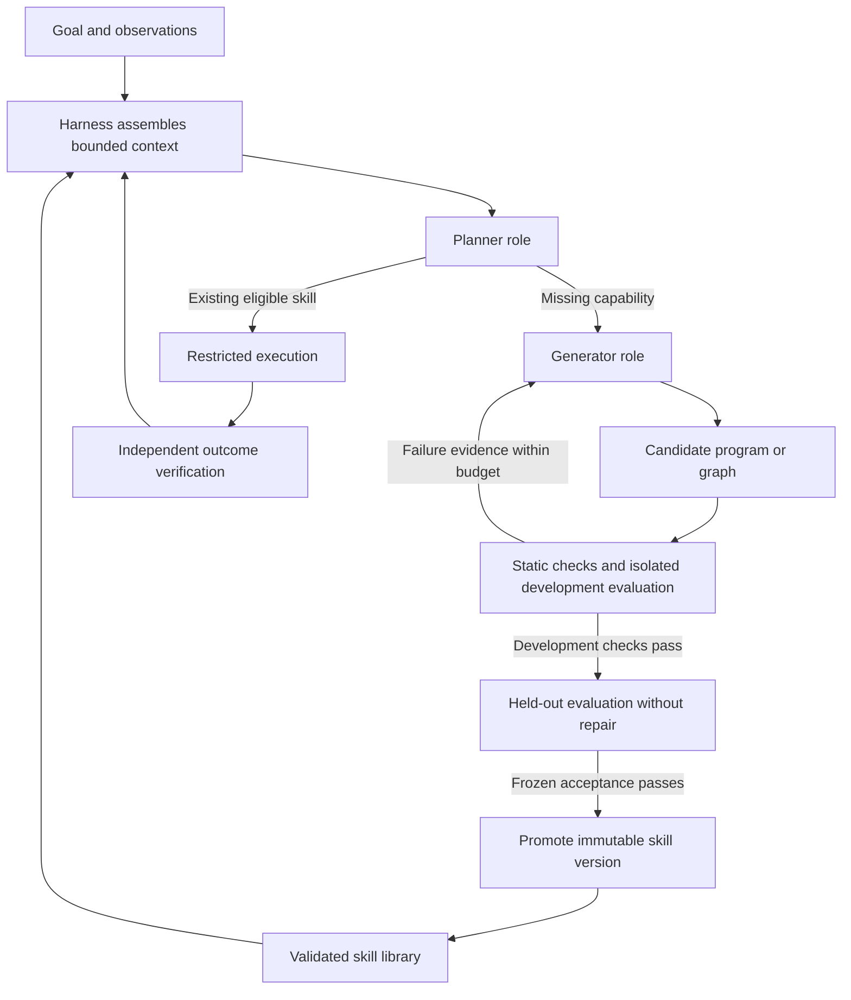
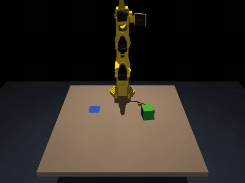

# Uzumaki

A robotics harness that uses execution feedback to develop and reuse robot skills.

**Status: early implementation.** This repository contains the architecture, roadmap and testing strategy, an offline harness baseline, and an optional MuJoCo simulation of the SO-101 arm running that baseline. It does not yet contain a live model in the loop, a trained model, or hardware support. A model planner and a skill generator with trace-guided repair are implemented and tested offline.

## What we are building

Uzumaki coordinates one powerful model in two roles: a planner selects existing skills or identifies missing capabilities; a generator creates or repairs candidate robot programs or graphs. The harness owns context, tool access, budgets, evaluation, evidence, and skill promotion. Validated skills handle routine decisions and retries within their declared scope.



Planning and generation initially use the same underlying model with separate prompts and contexts. A specialized decision model, an owned generator, predictive world models, parallel search, and physical robots are later experiments, not MVP prerequisites. The bounded executor may be a program or graph; it need not be another language model.

## Start here

- [Implementation roadmap](docs/roadmap.md): ordered features, dependencies, acceptance criteria, and issue links.
- [Architecture](docs/architecture.md): responsibilities, context flow, failure behavior, and model boundaries.
- [Task and evaluation protocol (candidate_for_review)](docs/protocol/README.md): the `pick-place-v1` candidate profile ([task-v1.json](docs/protocol/task-v1.json)) and [decision record 0001](docs/decisions/0001-task-and-evaluation.md). Pending PR acceptance (review revision 5, documentary only; zero trials, not a performance result; numerical targets and heldout commitments unchanged); simulator and model are unverified candidates.
- [Harness and model contracts 1.0](docs/contracts/README.md) (issue 02, documentary): versioned record schemas ([v1.json](docs/contracts/v1.json)), fixtures ([fixtures.json](docs/contracts/fixtures.json)), authority, admission and lifecycle rules; see the [feature note](docs/features/harness-contracts.md) and [CHANGELOG](CHANGELOG.md). Offline-checkable specifications only; no runtime enforces them yet.
- [Testing strategy](docs/testing.md): offline fixtures, containment, simulator tests, held-out evaluation, and evidence.
- [Contributing](CONTRIBUTING.md): how to take a feature from planned to verified.
- [Private GitHub Project](https://github.com/users/alokdidde/projects/4): all roadmap issues in Sequence order. Readiness distinguishes Ready, Blocked, and Deferred work.

## First delivery

Start with [issue 01 — freeze the first task and evaluation protocol](https://github.com/alokdidde/uzumaki/issues/1). It is the only feature initially marked Ready.

The proposed first task is one rigid-object pick-and-place family. Issue 01 proposes a candidate profile (`pick-place-v1`, not yet accepted) that freezes its task envelope, simulator, observations, budgets, evaluator, and thresholds before implementation. The first runnable slice will use deterministic fixtures, hand-authored skills, and a rule-based selector with no paid inference. Model generation and physics simulation follow in order.

The MVP ends at feature 18: one reproducible simulator-backed loop that selects existing skills, generates and repairs a missing skill, evaluates it, and promotes an accepted version with preserved evidence. It does not claim general robotics competence or authorize powered robot experiments.

## Simulation demo



The harness now runs in MuJoCo on a Robot Studio SO-101 arm: the same rule selector, hand-authored skills, budgets, independent evaluator and evidence bundles as the offline baseline, with physics underneath. All 28 SO-101 cases meet their frozen expectations. See [MuJoCo SO-101 simulation](docs/features/so101-simulation.md) and [decision 0002](docs/decisions/0002-so101-simulation.md). A Franka Panda runs the same harness and skills unchanged, on the original frozen `pick-place-v1` geometry: 28 of 28 cases ([Panda simulation](docs/features/panda-simulation.md), [GIF](docs/media/panda-nominal.gif)). ALOHA, with two arms, runs a second task pack, `handover`: the left arm picks a bar up and hands it to the right arm, which places it, 28 of 28 cases including a dropped handover it recovers from ([ALOHA handover](docs/features/aloha-handover.md), [GIF](docs/media/aloha-nominal.gif)). Spot stands on its four legs and runs the same frozen pick-and-place with the arm on its back, 28 of 28 cases ([Spot simulation](docs/features/spot-simulation.md), [GIF](docs/media/spot-nominal.gif)). A Unitree G1 humanoid, its pelvis on a stand, runs it with its left Dex3 hand, 28 of 28 cases ([G1 simulation](docs/features/g1-simulation.md), [GIF](docs/media/g1-nominal.gif)). TidyBot, a mobile manipulator, runs a third pack, `fetch`: it drives to a box on one table, picks it up, drives to a second table and places it, 28 of 28 cases including a drive that stops short ([TidyBot fetch](docs/features/tidybot-fetch.md), [GIF](docs/media/tidybot-nominal.gif)). A Claude planner through the Vercel AI Gateway can replace the rule selector (`--planner model`, [feature note](docs/features/model-planner.md)); it is tested offline and has not yet made a live call. The generator role can also write a missing skill as a sandboxed program and repair it from execution traces in the simulator, then confirm it on cases it never saw (`python -m uzumaki.sim.generate`, [feature note](docs/features/skill-generation.md), [decision 0003](docs/decisions/0003-skill-program-representation.md)); this too is tested offline with a scripted model only.

The whole loop also runs from one command: the planner abstains because no skill can move the box, the generator writes and repairs one, it is confirmed on withheld cases and promoted into a saved skill library, and the planner then completes the task with it (`python -m uzumaki.sim.demo`; `make demo-live PROVIDER=...` for a live run on any supported model; [feature note](docs/features/end-to-end-demo.md)). The model is configuration, not code: Anthropic, OpenAI, OpenRouter, the Vercel AI Gateway, a local Ollama or any OpenAI-compatible server, or the Codex CLI ([model backends](docs/features/model-backends.md)). The robot is configuration too: bodies are described as parts, effectors and capabilities, with ready-made configurations from a single arm to a humanoid or a quadruped with a jaw, and `python -m uzumaki.conformance` checks a new robot ([Add your robot](docs/guides/add-your-robot.md)).

```
python -m pip install -r requirements-dev.txt -r requirements-sim.txt && python -m pip install --no-deps -e .
make sim-assets   # fetch the pinned SO-101, Panda, ALOHA, TidyBot, Spot and G1 models (SHA-256 verified)
make sim          # simulator suite
MUJOCO_GL=osmesa make sim-demo   # bundles, summary and MP4 videos in build/sim
MUJOCO_GL=osmesa make sim-demo-panda   # the same on the Franka Panda
MUJOCO_GL=osmesa make sim-demo-aloha   # ALOHA handing a bar between two arms
MUJOCO_GL=osmesa make sim-demo-tidybot # TidyBot fetching a box between two tables
MUJOCO_GL=osmesa make sim-demo-spot    # Spot standing, picking and placing with its arm
MUJOCO_GL=osmesa make sim-demo-g1      # the G1 humanoid on a stand, with its left hand
```

## Testing today

Feature 03 adds a minimal Python package with a recorded/fake provider. After a one-time `python -m pip install -r requirements-dev.txt && python -m pip install --no-deps -e .`, run `make check` offline (see [package bootstrap](docs/features/package-bootstrap.md)). It needs no API keys; there is still no harness runtime.

Feature 04 adds an offline evidence library: a versioned, bounded, checksum-chained event log with sensitive-key redaction, and recorded-decision replay that uses no provider or environment. Fresh-model reevaluation and environment resimulation are explicitly unsupported. See [execution events and semantic replay](docs/features/event-evidence.md).

Feature 05 adds a bounded-run library. It enforces the contract lifecycle with idempotent terminal states, wall-time/model-call/step/retry/attempt/output budgets, and token/cost limits from reported usage only (unknown usage is never zero). It fences late results by run and attempt ID and keeps the progress that was reached on cancellation. A real-process deadline kills hung calls. These are tested with a fake clock and with real child processes; see [lifecycle and budgets](docs/features/lifecycle-budgets.md). There is still no full harness loop or live model.

Feature 06 adds a restricted worker for generated candidates. It admits only Linux x86_64 with Landlock ABI 6+ and seccomp; anything else is refused before a process starts. The worker runs with a scrubbed environment, a Landlock filesystem allowlist (read-only stdlib, system libraries and the candidate, one writable scratch directory), denied sockets, fork and exec, and CPU, memory, file, descriptor and output limits. Only declared, versioned tools are reachable through a host-side broker, and the watchdog and kill authority stay in the host. An adversarial suite covers file escape, credentials, network, subprocess escape, hangs, memory and output floods. It runs only on admitted hosts, and `make containment` fails instead of skipping elsewhere. No tested platform is claimed until an independent validation run passes; see [restricted worker](docs/features/restricted-worker.md).

Feature 07 adds a versioned skill registry. Skills are immutable, SHA-256-bound artifacts with instructions, input/output contracts, applicability, tool permissions, resource bounds and completion/failure semantics. The `candidate`, `validated`, `deprecated` and `rejected` states are kept separate, and running tasks pin a version that later registry changes cannot alter. The registry rejects tampering, duplicate or conflicting IDs, unknown tools and incompatible dependencies. A hand-authored skill set loads offline without any model provider; see [skill registry](docs/features/skill-registry.md). Promotion with verified evidence is feature 17.

Feature 08 adds the first offline execution baseline. It runs eight frozen `pick-place-v1` fixture cases (nominal, unreachable goal, failed grasp, stale observations, retry exhaustion, cancellation and worker crash). Each case goes from goal through observation, eligibility, a rule-based selector, hand-authored skills, bounded execution and retries to an independent fixture evaluator and a final event bundle, with no model or paid API. Recorded-decision replay of every case must match a fresh run. Development trials reject candidates that stay still or only report success. The world is a scripted fixture, not a simulator; see [offline baseline](docs/features/offline-baseline.md).

The package above has executable offline checks. Separate protocol and contract validation remains documentary (see the [protocol README](docs/protocol/README.md#documentary-commands-offline-no-network-no-install)) and checks the documentation, roadmap ordering/dependencies, and GitHub setup. The issue-02 contracts add an offline schema/fixture check run by an external trusted checker ([contracts README](docs/contracts/README.md#offline-check-reproduction)); it executes no application code. Feature 03 provides the locked package and executable checks above; the harness, simulator and live-model integration remain future work. Do not treat other planned commands or unchecked issue criteria as passing tests.

All default implementation tests will use recorded/fake providers with live network access disabled. Simulator and paid-model tests will be explicit separate suites. Generated code must run only in a restricted worker whose protection does not depend on the generated code returning.

## Research foundations

- [ASPIRE](https://arxiv.org/abs/2607.00272): trace-guided program repair and reusable repair guidance.
- [ENPIRE](https://arxiv.org/abs/2606.19980): repeated physical experiments with reset and outcome verification.
- [GaP](https://arxiv.org/abs/2607.05369): executable policy graphs refined through simulation feedback.

These are research inputs, not inherited performance or safety guarantees. Uzumaki is independent of HefaOS. No code or historical implementation from that project is imported.

## Privacy

The repository and planning Project are private. Do not commit API keys, raw private observations, customer data, trained weights, or execution bundles. Record artifact hashes and access-controlled retention locations when evidence is too large or sensitive for Git. A license has not yet been selected; no open-source license grant is made by this bootstrap.
