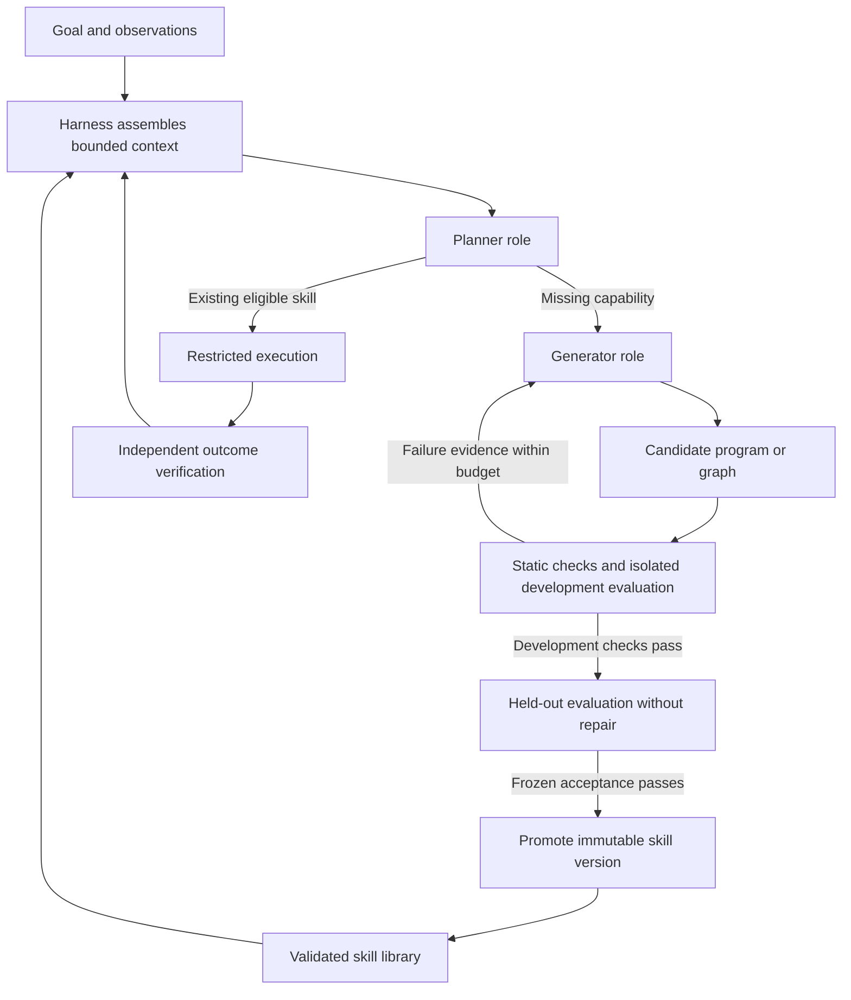

# Uzumaki

A robotics harness that uses execution feedback to develop and reuse robot skills.

**Status: planning bootstrap.** This repository currently contains architecture, an implementation roadmap, and a testing strategy. It does not yet contain a runnable harness, trained model, simulator integration, or hardware support.

## What we are building

Uzumaki coordinates one powerful model in two roles: a planner selects existing skills or identifies missing capabilities; a generator creates or repairs candidate robot programs or graphs. The harness owns context, tool access, budgets, evaluation, evidence, and skill promotion. Validated skills handle routine decisions and retries within their declared scope.

Planning and generation initially use the same underlying model with separate prompts and contexts. A specialized decision model, an owned generator, predictive world models, parallel search, and physical robots are later experiments, not MVP prerequisites. The bounded executor may be a program or graph; it need not be another language model.

## Start here

- [Implementation roadmap](docs/roadmap.md): ordered features, dependencies, acceptance criteria, and issue links.
- [Architecture](docs/architecture.md): responsibilities, context flow, failure behavior, and model boundaries.
- [Task and evaluation protocol (candidate_for_review)](docs/protocol/README.md): the `pick-place-v1` candidate profile ([task-v1.json](docs/protocol/task-v1.json)) and [decision record 0001](docs/decisions/0001-task-and-evaluation.md). Pending PR acceptance (review revision 5, documentary only; zero trials, not a performance result; numerical targets and heldout commitments unchanged); simulator and model are unverified candidates.
- [Harness and model contracts 1.0](docs/contracts/README.md) (issue 02, documentary): versioned record schemas ([v1.json](docs/contracts/v1.json)), fixtures ([fixtures.json](docs/contracts/fixtures.json)), authority, admission and lifecycle rules; see the [feature note](docs/features/harness-contracts.md) and [CHANGELOG](CHANGELOG.md). Offline-checkable specifications only; no runtime enforces them yet.
- [Testing strategy](docs/testing.md): offline fixtures, containment, simulator tests, held-out evaluation, and evidence.
- [Contributing](CONTRIBUTING.md): how to take a feature from planned to verified.
- [Private GitHub Project](https://github.com/users/alokdidde/projects/4): all roadmap issues in Sequence order. Readiness distinguishes Ready, Blocked, and Deferred work.

## First delivery

Start with [issue 01 — freeze the first task and evaluation protocol](https://github.com/alokdidde/uzumaki/issues/1). It is the only feature initially marked Ready.

The proposed first task is one rigid-object pick-and-place family. Issue 01 proposes a candidate profile (`pick-place-v1`, not yet accepted) that freezes its task envelope, simulator, observations, budgets, evaluator, and thresholds before implementation. The first runnable slice will use deterministic fixtures, hand-authored skills, and a rule-based selector with no paid inference. Model generation and physics simulation follow in order.

The MVP ends at feature 18: one reproducible simulator-backed loop that selects existing skills, generates and repairs a missing skill, evaluates it, and promotes an accepted version with preserved evidence. It does not claim general robotics competence or authorize powered robot experiments.

## Testing today

Feature 03 adds a minimal Python package with a recorded/fake provider. After a one-time `python -m pip install -r requirements-dev.txt && python -m pip install --no-deps -e .`, run `make check` offline (see [package bootstrap](docs/features/package-bootstrap.md)). It needs no API keys; there is still no harness runtime.

Feature 04 adds an offline evidence library: a versioned, bounded, checksum-chained event log with sensitive-key redaction, and recorded-decision replay that uses no provider or environment. Fresh-model reevaluation and environment resimulation are explicitly unsupported. See [execution events and semantic replay](docs/features/event-evidence.md).

Feature 05 adds a bounded-run library. It enforces the contract lifecycle with idempotent terminal states, wall-time/model-call/step/retry/attempt/output budgets, and token/cost limits from reported usage only (unknown usage is never zero). It fences late results by run and attempt ID and keeps the progress that was reached on cancellation. A real-process deadline kills hung calls. These are tested with a fake clock and with real child processes; see [lifecycle and budgets](docs/features/lifecycle-budgets.md). There is still no full harness loop, sandbox or live model.

The package above has executable offline checks. Separate protocol and contract validation remains documentary (see the [protocol README](docs/protocol/README.md#documentary-commands-offline-no-network-no-install)) and checks the documentation, roadmap ordering/dependencies, and GitHub setup. The issue-02 contracts add an offline schema/fixture check run by an external trusted checker ([contracts README](docs/contracts/README.md#offline-check-reproduction)); it executes no application code. Feature 03 provides the locked package and executable checks above; the harness, simulator and live-model integration remain future work. Do not treat other planned commands or unchecked issue criteria as passing tests.

All default implementation tests will use recorded/fake providers with live network access disabled. Simulator and paid-model tests will be explicit separate suites. Generated code must run only in a restricted worker whose protection does not depend on the generated code returning.

## Research foundations

- [ASPIRE](https://arxiv.org/abs/2607.00272): trace-guided program repair and reusable repair guidance.
- [ENPIRE](https://arxiv.org/abs/2606.19980): repeated physical experiments with reset and outcome verification.
- [GaP](https://arxiv.org/abs/2607.05369): executable policy graphs refined through simulation feedback.

These are research inputs, not inherited performance or safety guarantees. Uzumaki is independent of HefaOS. No code or historical implementation from that project is imported.

## Privacy

The repository and planning Project are private. Do not commit API keys, raw private observations, customer data, trained weights, or execution bundles. Record artifact hashes and access-controlled retention locations when evidence is too large or sensitive for Git. A license has not yet been selected; no open-source license grant is made by this bootstrap.
