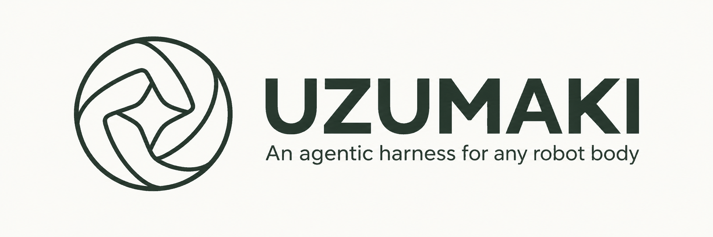
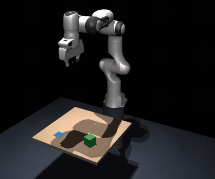
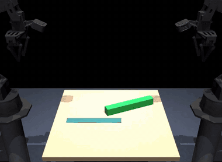
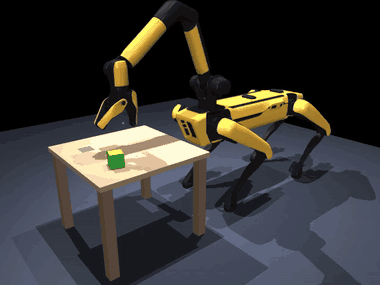
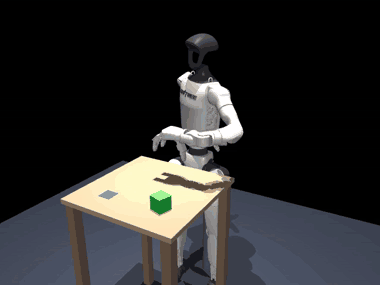
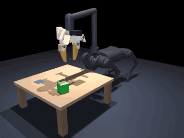
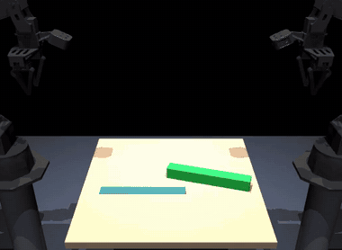
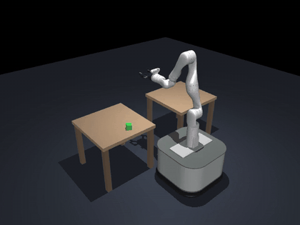
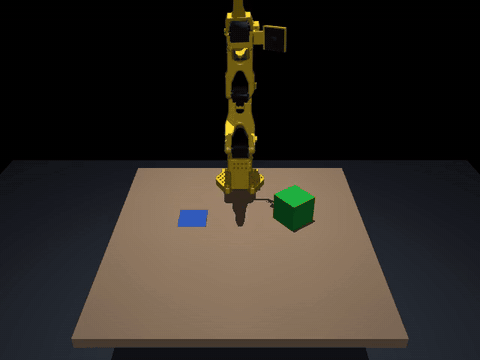
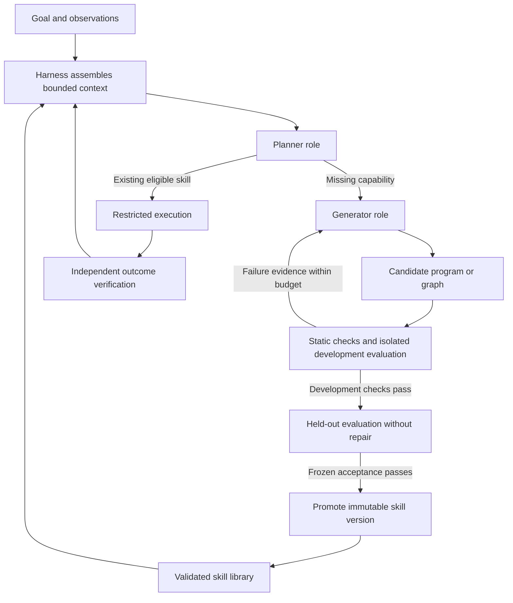

<!-- Banner slot: replace this comment with
<p align="center"></p>
once the banner is in docs/media. -->

<h1 align="center">Uzumaki</h1>

<p align="center">
<b>An agentic harness that grows robot skills from execution feedback, for any body and any model.</b><br>
<sub>渦巻き (uzumaki): a spiral. Plan, try, observe, repair, promote, reuse.</sub>
</p>

<p align="center">
<a href="https://github.com/alokdidde/uzumaki/actions/workflows/ci.yml"></a>


</p>

<p align="center">
<a href="#one-harness-eight-bodies">Robots</a> ·
<a href="#how-it-works">How it works</a> ·
<a href="#any-model">Any model</a> ·
<a href="#quick-start">Quick start</a> ·
<a href="docs/guides/add-your-robot.md">Add your robot</a> ·
<a href="docs/roadmap.md">Roadmap</a>
</p>

## One harness, eight bodies

The same harness core, evaluator, selector and evidence format run every robot below in MuJoCo. A robot joins as a description and an adapter. Each result is its frozen development set (28 cases, including injected faults such as failed grasps, stale observations, worker crashes and cancellation), plus a robustness probe of extra random geometries that is not part of acceptance. Click a robot for its feature note.

<table>
<tr>
<td align="center" valign="top" width="33%">
<a href="docs/features/so101-simulation.md"></a><br>
<b>SO-101 · single arm</b><br>
<sub>pick-place · <b>28/28</b> dev cases<br>probe 199/200</sub>
</td>
<td align="center" valign="top" width="33%">
<a href="docs/features/panda-simulation.md"></a><br>
<b>Franka Panda · single arm</b><br>
<sub>pick-place · <b>28/28</b><br>probe 200/200 · same skills, unchanged</sub>
</td>
<td align="center" valign="top" width="33%">
<a href="docs/features/aloha-handover.md"></a><br>
<b>ALOHA · two arms</b><br>
<sub>handover · <b>28/28</b><br>probe 100/100 · recovers a dropped handover</sub>
</td>
</tr>
<tr>
<td align="center" valign="top" width="33%">
<a href="docs/features/tidybot-fetch.md"></a><br>
<b>TidyBot · mobile manipulator</b><br>
<sub>fetch · <b>28/28</b><br>probe 197/200 · recovers a drive that stops short</sub>
</td>
<td align="center" valign="top" width="33%">
<a href="docs/features/spot-simulation.md"></a><br>
<b>Spot · quadruped with arm</b><br>
<sub>pick-place · <b>28/28</b><br>probe 200/200</sub>
</td>
<td align="center" valign="top" width="33%">
<a href="docs/features/g1-simulation.md"></a><br>
<b>Unitree G1 · humanoid</b><br>
<sub>pick-place · <b>28/28</b> with its left Dex3 hand<br>probe 187/200, the rest safely refused</sub>
</td>
</tr>
<tr>
<td align="center" valign="top" width="33%">
<a href="docs/features/go1-simulation.md"></a><br>
<b>Unitree Go1 · quadruped with jaw</b><br>
<sub>pick-place · <b>28/28</b>, gripping with its head<br>probe 200/200</sub>
</td>
<td align="center" valign="top" width="33%">
<a href="docs/features/go1-walk-fetch.md"></a><br>
<b>Go1, walking</b><br>
<sub>fetch · <b>28/28</b> on a learned walking policy<br>probe 200/200</sub>
</td>
<td align="center" valign="middle" width="33%">
<a href="docs/guides/add-your-robot.md"><b>➕ Your robot</b></a><br><br>
<sub>Describe the body as parts, effectors and capabilities, write an adapter, and run <code>python -m uzumaki.conformance</code>. The core never changes.</sub>
</td>
</tr>
</table>

### It notices when things go wrong

Every case ends with an independent outcome check, not the robot's own claim of success. Faults are injected on purpose, and the harness has to see them and recover within its budget.

<table>
<tr>
<td align="center" width="33%"><br><sub>ALOHA drops the bar mid-handover, sees it, and picks it up again.</sub></td>
<td align="center" width="33%"><br><sub>TidyBot's drive stops short; nothing is in reach, so it drives again.</sub></td>
<td align="center" width="33%"><br><sub>The SO-101 misses a grasp; the evaluator catches it and the skill retries.</sub></td>
</tr>
</table>

## How it works

One model plays two roles. The **planner** picks a validated skill for the goal, or says that none fits. The **generator** then writes the missing skill as a small sandboxed program, runs it in the simulator, and repairs it from execution traces until it passes. It is confirmed on cases it never saw and promoted into the skill library as an immutable version, and the planner uses it from then on.



The harness owns context, tool access, budgets, evaluation, evidence and promotion. Generated code runs only in a [restricted worker](docs/features/restricted-worker.md) (Landlock and seccomp, no network, no exec) whose protection does not depend on the program returning. Every run leaves a checksum-chained [evidence bundle](docs/features/event-evidence.md) that can be replayed.

The whole loop runs from one command. The planner abstains because no skill can move the box, the generator writes and repairs one, it is confirmed and promoted, and the planner completes the task with it ([end-to-end demo](docs/features/end-to-end-demo.md)):

```
python -m uzumaki.sim.demo                 # scripted model, offline
make demo-live PROVIDER=codex              # a live model (see below)
```

**It has run live.** On 2026-10-22, through the Codex CLI signed in with ChatGPT, the planner abstained, Codex wrote `transfer-box` on its first attempt, it passed 16/16 development and 12/12 unseen cases, was promoted as `transfer-box@1`, and the planner then completed the task with 0 violations, all in 3 model calls ([live runs](docs/features/end-to-end-demo.md#live-runs)).

## Any model

The model is configuration, not code. Pick a backend with `--provider` and `--model`, or `UZUMAKI_PROVIDER` and `UZUMAKI_MODEL` ([model backends](docs/features/model-backends.md)):

| Backend | Example |
| --- | --- |
| Anthropic | `make demo-live PROVIDER=anthropic` |
| OpenAI | `make demo-live PROVIDER=openai MODEL=gpt-5` |
| OpenRouter | `make demo-live PROVIDER=openrouter MODEL=anthropic/claude-sonnet-5.5` |
| Vercel AI Gateway (default) | `make demo-live` |
| Ollama (local) | `make demo-live PROVIDER=ollama MODEL=qwen3` |
| Any OpenAI-compatible server | `make demo-live PROVIDER=openai-compatible BASE_URL=https://host/v1 MODEL=m API_KEY_ENV=MY_KEY` |
| Codex CLI (ChatGPT sign-in) ✅ run live | `make demo-live PROVIDER=codex` |

All backends are tested offline; so far only the Codex CLI has run live.

## Any body

Bodies are described in three layers: ready-made configurations, components you can mount anywhere, and the parts, effectors and capabilities underneath. Skills target a configuration or a capability, so a limb may walk and a head may grip.

| Configuration | Robots here |
| --- | --- |
| `SingleArm` | SO-101, Franka Panda |
| `TwoArms` | ALOHA |
| `MobileManipulator` | TidyBot |
| `Humanoid` | Unitree G1 |
| `QuadrupedWithArm` | Spot |
| `QuadrupedWithJaw` | Unitree Go1 (standing and walking) |
| `Quadruped` | ready for your robot |

Three task packs run on them today: `pick-place`, `handover` and `fetch`. [Add your robot](docs/guides/add-your-robot.md) walks through the exact steps the SO-101 took.

## Quick start

```
python -m pip install -r requirements-dev.txt -r requirements-sim.txt && python -m pip install --no-deps -e .
make check        # offline tests, no API keys
make sim-assets   # fetch the pinned robot models and the Go1 walking policy (SHA-256 verified)
make sim          # simulator suite
MUJOCO_GL=osmesa make sim-demo          # SO-101: bundles, summary and MP4 videos in build/sim
MUJOCO_GL=osmesa make sim-demo-panda    # Franka Panda
MUJOCO_GL=osmesa make sim-demo-aloha    # ALOHA handing a bar between two arms
MUJOCO_GL=osmesa make sim-demo-tidybot  # TidyBot fetching a box between two tables
MUJOCO_GL=osmesa make sim-demo-spot     # Spot picking with the arm on its back
MUJOCO_GL=osmesa make sim-demo-g1       # the G1 humanoid on a stand, left hand
MUJOCO_GL=osmesa make sim-demo-go1      # the Go1 gripping with a jaw on its neck
MUJOCO_GL=osmesa make sim-demo-go1-walk # the Go1 walking on a learned policy
```

## Status

Early implementation. The harness, eight simulated bodies, the model planner and the skill generator with trace-guided repair are implemented. The planner and generator are tested offline with a scripted model, and the whole loop has run live once, through the Codex CLI. There are no held-out evaluation sets yet, no trained model of our own, and no hardware support; the GIFs above are simulation only. The MVP ends at feature 18 of the [roadmap](docs/roadmap.md): one reproducible simulator-backed loop that selects, generates, repairs, evaluates and promotes skills with preserved evidence. It does not claim general robotics competence or authorize powered robot experiments.

<details>
<summary>Feature history and what each test suite covers</summary>

Feature 03 adds a minimal Python package with a recorded/fake provider. After a one-time `python -m pip install -r requirements-dev.txt && python -m pip install --no-deps -e .`, run `make check` offline (see [package bootstrap](docs/features/package-bootstrap.md)). It needs no API keys; there is still no harness runtime.

Feature 04 adds an offline evidence library: a versioned, bounded, checksum-chained event log with sensitive-key redaction, and recorded-decision replay that uses no provider or environment. Fresh-model reevaluation and environment resimulation are explicitly unsupported. See [execution events and semantic replay](docs/features/event-evidence.md).

Feature 05 adds a bounded-run library. It enforces the contract lifecycle with idempotent terminal states, wall-time/model-call/step/retry/attempt/output budgets, and token/cost limits from reported usage only (unknown usage is never zero). It fences late results by run and attempt ID and keeps the progress that was reached on cancellation. A real-process deadline kills hung calls. These are tested with a fake clock and with real child processes; see [lifecycle and budgets](docs/features/lifecycle-budgets.md). There is still no full harness loop or live model.

Feature 06 adds a restricted worker for generated candidates. It admits only Linux x86_64 with Landlock ABI 6+ and seccomp; anything else is refused before a process starts. The worker runs with a scrubbed environment, a Landlock filesystem allowlist (read-only stdlib, system libraries and the candidate, one writable scratch directory), denied sockets, fork and exec, and CPU, memory, file, descriptor and output limits. Only declared, versioned tools are reachable through a host-side broker, and the watchdog and kill authority stay in the host. An adversarial suite covers file escape, credentials, network, subprocess escape, hangs, memory and output floods. It runs only on admitted hosts, and `make containment` fails instead of skipping elsewhere. No tested platform is claimed until an independent validation run passes; see [restricted worker](docs/features/restricted-worker.md).

Feature 07 adds a versioned skill registry. Skills are immutable, SHA-256-bound artifacts with instructions, input/output contracts, applicability, tool permissions, resource bounds and completion/failure semantics. The `candidate`, `validated`, `deprecated` and `rejected` states are kept separate, and running tasks pin a version that later registry changes cannot alter. The registry rejects tampering, duplicate or conflicting IDs, unknown tools and incompatible dependencies. A hand-authored skill set loads offline without any model provider; see [skill registry](docs/features/skill-registry.md). Promotion with verified evidence is feature 17.

Feature 08 adds the first offline execution baseline. It runs eight frozen `pick-place-v1` fixture cases (nominal, unreachable goal, failed grasp, stale observations, retry exhaustion, cancellation and worker crash). Each case goes from goal through observation, eligibility, a rule-based selector, hand-authored skills, bounded execution and retries to an independent fixture evaluator and a final event bundle, with no model or paid API. Recorded-decision replay of every case must match a fresh run. Development trials reject candidates that stay still or only report success. The world is a scripted fixture, not a simulator; see [offline baseline](docs/features/offline-baseline.md).

The package above has executable offline checks. Separate protocol and contract validation remains documentary (see the [protocol README](docs/protocol/README.md#documentary-commands-offline-no-network-no-install)) and checks the documentation, roadmap ordering/dependencies, and GitHub setup. The issue-02 contracts add an offline schema/fixture check run by an external trusted checker ([contracts README](docs/contracts/README.md#offline-check-reproduction)); it executes no application code. Feature 03 provides the locked package and executable checks above; the harness, simulator and live-model integration remain future work. Do not treat other planned commands or unchecked issue criteria as passing tests.

All default implementation tests will use recorded/fake providers with live network access disabled. Simulator and paid-model tests will be explicit separate suites. Generated code must run only in a restricted worker whose protection does not depend on the generated code returning.

</details>

## Docs

- [Implementation roadmap](docs/roadmap.md): ordered features, dependencies, acceptance criteria and issue links.
- [Architecture](docs/architecture.md): responsibilities, context flow, failure behavior and model boundaries.
- [Task and evaluation protocol](docs/protocol/README.md): the `pick-place-v1` profile ([task-v1.json](docs/protocol/task-v1.json)) and [decision 0001](docs/decisions/0001-task-and-evaluation.md).
- [Harness and model contracts 1.0](docs/contracts/README.md): versioned record schemas, fixtures, authority, admission and lifecycle rules ([feature note](docs/features/harness-contracts.md), [CHANGELOG](CHANGELOG.md)).
- [Testing strategy](docs/testing.md): offline fixtures, containment, simulator tests, held-out evaluation and evidence.
- [Feature notes](docs/features/): one per delivered feature, with frozen plans and results.
- [Contributing](CONTRIBUTING.md): how to take a feature from planned to verified.
- [Private GitHub Project](https://github.com/users/alokdidde/projects/4): all roadmap issues in sequence order.

## Research foundations

- [ASPIRE](https://arxiv.org/abs/2607.00272): trace-guided program repair and reusable repair guidance.
- [ENPIRE](https://arxiv.org/abs/2606.19980): repeated physical experiments with reset and outcome verification.
- [GaP](https://arxiv.org/abs/2607.05369): executable policy graphs refined through simulation feedback.

These are research inputs, not inherited performance or safety guarantees. Uzumaki is independent of HefaOS. No code or historical implementation from that project is imported.

## Privacy

The repository and planning Project are private. Do not commit API keys, raw private observations, customer data, trained weights, or execution bundles. Record artifact hashes and access-controlled retention locations when evidence is too large or sensitive for Git. A license has not yet been selected; no open-source license grant is made by this bootstrap.
