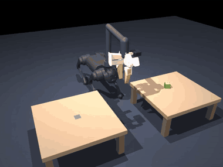

# MuJoCo Go1 walking to fetch a box

Status: implemented in the optional `uzumaki.sim` package, tested by `tests/test_go1_walk.py` (part of `make sim` and the CI simulator job). It is the first robot on the harness that walks: the Unitree Go1 with a jaw on its neck (the [standing Go1](go1-simulation.md)) walks on a learned locomotion policy to a box on one table, picks it up with its jaw, walks to a second table and places it on the target. It runs the same `fetch-v1` task pack, skills and selector as [TidyBot](tidybot-fetch.md).

The [stopped-short case](../media/go1-walk-stopped-short.gif) shows recovery: an injected fault stops the first walk partway, the observation says nothing is within reach, and the next attempt walks again and completes.

## What was added

- **A walking policy.** The legs are driven by MuJoCo Playground's Go1 joystick policy, a neural network trained in simulation with reinforcement learning, run here in ONNX format with `onnxruntime` (a new pinned dependency in `requirements-sim.txt`). Every 20 ms it reads the trunk's velocity, rotation rate and tilt, the leg joints and its last action, plus a velocity command (forward, sideways, turn), and sets the twelve leg targets. No model or policy was trained here.
- **The model it was trained on.** The policy was trained on Playground's own Go1 model: softer leg servos than Menagerie's, and collisions on the feet only. `uzumaki.sim.go1_walk` builds on that model and adds the standing Go1's neck and UMI jaw to it, unchanged (`go1.add_neck_and_jaw`). Two settings differ from Playground's, both because of the neck: the integrator is implicit-fast and the solver runs MuJoCo's default iterations. The policy still walks with them: it holds still on a zero command, walks forward at about 0.5 m/s, sidesteps, and turns in place.
- **Collisions.** The legs and trunk also collide with the tables, though not with the floor (the policy was trained without that). So a foot or leg that touches a table is a forbidden contact, as is any robot contact with the floor except the feet.
- **Walking to a station (`go_to`).** As for TidyBot, `go_to` admits a point on a table and goes to that table's work station: the trunk centre 0.30 m from the table's -y edge, facing +y. TidyBot's base stands 0.27 m off, but the dog's front feet swing forward of its shoulders. A proportional controller turns the remaining distance into the policy's velocity command. The policy stands still for commands slower than about 0.3 m/s, so the dog walks at 0.35 to 0.45 m/s until it is within 3 cm of the station, then turns in place until its heading is within 3°. It then stands for a second on a zero command, and the legs hold that stance while the neck works.
- **Planning from where the trunk stands.** The trunk's pose comes from the physics after every walk, and `pick` and `place` plan from it. On the policy's softer legs, the trunk dips a few millimetres when the neck reaches out. So once the jaw is over the box, and again over the target, the descent is planned again from the pose the trunk holds then. To allow this, the shared engine and TidyBot's world each gained one hook (`_replan_grasp` and `_replan_place`); both do nothing by default, so other robots behave as before.
- **Reach.** `pick` and `place` are admitted for a pose on a table 0.30 to 0.72 m from the trunk centre and within 20° of its heading.
- **The embodiment** `go1_walk` is a `QuadrupedWithJaw` description with the standing Go1's legs, neck and jaw. On `fetch`, conformance binds `go_to` to the four legs and `pick` and `place` to the neck.
- **Assets from a second source.** A pinned model can now come from a repository other than Menagerie, at its own commit. `go1_walk` pins three files from MuJoCo Playground at commit `12ad7f38`, all Apache-2.0: the model, the policy and the LICENSE. The model's meshes come from the pinned Menagerie Go1.

The harness core, the evaluator, the driver, the skills and the evidence format did not change.

## Frozen plan

- **Workload:** the 28 cases in `src/uzumaki/sim/data/go1_walk_cases_v1.json` (case set `go1-walk-dev-v1`), rebuilt by `uzumaki.sim.go1_walk.build_case_set` and checked by a test.
  - The construction is TidyBot's: eight fault cases (`nominal`, `unreachable-goal`, `failed-grasp`, `stopped-short`, `stale-observation`, `retry-exhausted`, `cancellation`, `worker-crash`), then twenty nominal cases.
  - The geometry comes from the same seed recipe, on its own seeds `go1-walk-1001` to `go1-walk-1028`.
  - The unreachable-goal case puts the target between the tables.
  - The dog starts at (0.4, -0.52) facing +y, at neither table.
- **Environment:**
  - **Models:** the Playground Go1 model and policy above, with the Menagerie Go1 meshes and UMI gripper (`make sim-assets`).
  - **Room:** tables 0.2 m high, at the dog's shoulder.
  - **Physics:** timestep 5 ms; the policy acts every fourth step.
- **Correctness guards:** as for TidyBot.
  - Frozen expectations are met, including how many `go_to`, `pick` and `place` calls were admitted.
  - There is no forbidden contact.
  - Replaying the recorded decisions gives the same outcome, walking included.
  - Completed cases end within 0.02 m and 10°.
- **Reproduction:**
  - Tests: `make sim-assets && make sim`.
  - Evidence and videos: `MUJOCO_GL=osmesa make sim-demo-go1-walk` (or `python -m uzumaki.sim --robot go1_walk`).
  - Conformance: `python -m uzumaki.conformance --embodiment go1_walk --task fetch`.

## Results on this branch

- **Dev cases:** all 28 met their frozen expectations with no forbidden contact. Completed cases ended within 0.0039 m and 0.3° of the target. The 28 cases take about 12 s of wall time together.
- **Conformance:** the `go1_walk` embodiment passes all eight checks on `fetch`.
- **Robustness probe** (not frozen, not acceptance): 200 extra geometries from the same recipe on seeds `sweep-0` to `sweep-199`. All 200 completed with no contact (worst 0.0053 m, 0.3°).

## Limitations

- **Simulated development results only.** There is no held-out case set for `fetch-v1` yet; whoever keeps it should draw it from seeds not in this file. There is no physical-robot claim.
- **Walk, then stand.** The dog walks and manipulates in turn, not at once: while the neck works, the legs hold the stance the policy stopped in.
- **Not the policy's training conditions.** The policy was trained without a neck, a jaw or their weight, at a 4 ms physics step with one solver iteration. Here it carries about 3 kg of neck and jaw, a fifth of its weight, at a 5 ms step with MuJoCo's default solver. It walked every case here, but that is measured only on these flat floors and these short walks.
- **Navigation.** As for TidyBot, navigation is a walk to a fixed station in front of a table, with a straight-path check against the tables only. There is no map, no obstacle avoidance and no odometry error: the walk is steered by the true trunk pose.
- **A modelled neck and jaw**, as for the [standing Go1](go1-simulation.md#limitations).
